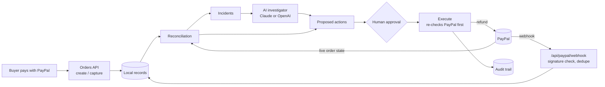

# PayTrace AI

Payment observability and recovery for merchants on PayPal.

When a payment goes wrong (a webhook is lost, the app crashes after capture, a refund happens outside the app), the merchant's database and PayPal disagree. Usually nobody notices until a customer complains. PayTrace finds these mismatches, has an AI investigator explain what happened and what it costs, and lets a person approve the fix. Every step is checked against PayPal and recorded.

## The flow

```
PayPal checkout -> webhook -> PayPal vs local mismatch -> incident
  -> AI explains root cause and impact -> recovery proposed
  -> human approves -> PayPal re-checked -> action runs -> incident resolves -> audit trail
```



## How it uses PayPal

- **Orders v2:** create, get and capture. The dashboard has PayPal Smart Buttons (`@paypal/react-paypal-js`) for test checkouts.
- **Webhooks:** every event is verified with PayPal's `verify-webhook-signature` API. Duplicate deliveries (same event `id`) are processed once, and PayPal gets its 2xx before reconciliation runs. Delivery order isn't assumed: an event applies only if its resource `update_time` is at least as new as the last one applied, and it can never move a payment backwards.
- **Reconciliation:** PayPal's live order and capture state is the source of truth. Webhook payloads are never trusted for that.
- **Payments v2 refunds:** run only after approval. Each refund has one stored `PayPal-Request-Id` and `invoice_id`, reused on every retry (see *Refund retries* below).

## How it uses AI

`POST /api/incidents/:id/investigate` sends the configured model (Claude or OpenAI) the incident, the live PayPal order, the local record, the webhook history and earlier recovery actions. It returns structured, schema-validated output:

- root cause and explanation, citing the evidence
- confidence
- financial impact and customer impact
- recommended actions

The AI never moves money. Its recommendations become `PROPOSED` actions that go through the same approval rules as everything else.

## Safety model

| Rule | Where |
|---|---|
| AI and the system can propose but never approve or execute | `lib/recovery/propose.ts`, `actions.ts` |
| The approver must be a different person from the proposer | `approveAction` |
| Refunds need an explicit "this moves money" acknowledgement | `approveAction` |
| Each refund gets one `PayPal-Request-Id` and `invoice_id` at approval, reused on every retry | `approveAction`, `refundCapture` |
| A refund with an unknown outcome (timeout, 5xx, `PREVIOUS_REQUEST_IN_PROGRESS`) becomes `UNCERTAIN` and can only be retried with the same ID | `executeAction` |
| While a refund on an order is unresolved, no other refund on that order can be proposed or run; after one executes, only a person can propose another | `findUnresolvedRefund` |
| Live PayPal state is re-checked before running: an existing refund with our `invoice_id` is detected, and the remaining refundable amount is checked | `refundCapture` |
| An action can only be executed once, even with concurrent clicks | atomic claim into `EXECUTING` |
| Every state change is in an append-only audit trail | `RecoveryAction.audit` |
| Optional passcode for approvals, staging and AI runs on a public URL | `PAYTRACE_APPROVER_PASSCODE` |

### Refund retries

A refund that times out is the dangerous case: PayPal may have processed it even though no answer came back. PayTrace handles it like this:

1. When a person approves a refund, it is given one `PayPal-Request-Id` (a UUID) and one `invoice_id`. Both are saved before any request is sent.
2. Each attempt is recorded in the audit trail *before* the request goes out.
3. On success, including PayPal replaying the original result for a repeated request ID, the refund ID is stored and the action is `EXECUTED`.
4. On `400`/`422`, PayPal refused the request, so it is `FAILED` and no money moved. This only applies if no earlier attempt was sent.
5. On a timeout, a 5xx or `409 PREVIOUS_REQUEST_IN_PROGRESS`, PayTrace looks at PayPal once for a refund carrying our `invoice_id`. If none is found, the action is `UNCERTAIN`.
6. Retrying an `UNCERTAIN` refund first checks PayPal again, then resends with the **same** request ID. PayPal returns the earlier result instead of creating a second refund.

PayPal's docs don't say whether it rejects a duplicate `invoice_id` on refunds, so PayTrace uses it to *find* an earlier refund, not as an enforced block. The request ID is the primary guard.

### Webhook recovery (known gap)

Missed webhooks are recovered through state, not events. Reconciliation always reads the live PayPal order, so a lost `PAYMENT.CAPTURE.COMPLETED` still shows up as a mismatch the next time the order is reconciled. What's not built:

- **No webhook backfill.** PayTrace doesn't call PayPal's webhook event list or resend APIs, so the event history in the grid can have gaps.
- **No schedule.** Reconciliation runs after each webhook, after each recovery action, and on *Reconcile all*. For production, call `POST /api/reconcile` on a schedule (cron).
- **Only known orders are checked.** An order PayTrace has never seen (no local record and no webhook) won't be found.

## Dashboard (AG Grid)

Four linked grids: incidents, transactions, webhook events and recovery actions.

- Incidents sort open first, then by severity, then by recency. Open high and critical rows are highlighted.
- Columns cover amount at risk, PayPal vs local state, AI analysis state and actions awaiting approval.
- The transactions grid shows each order's reconciliation state (in sync, mismatch, not checked).
- Quick search works across every grid, and money columns sort and filter as numbers.
- Clicking an incident opens its evidence, webhook timeline, AI analysis, and the approve / reject / execute controls with each action's audit trail.

## Running locally

```bash
npm install
cp .env.example .env.local   # add PayPal Sandbox credentials and ANTHROPIC_API_KEY or OPENAI_API_KEY
npm run dev
```

Open http://localhost:3000.

## Demo script (about 3 minutes)

1. **Pay.** Use the PayPal button under *Test checkout* and log in as a sandbox buyer. The order shows up in *Transactions*, along with webhook events if a webhook is registered.
2. **Break it.** Open the order and click *Simulate lost update*. This pretends the app crashed right after PayPal captured the money. Reconciliation runs and opens a `STATE_MISMATCH` incident: PayPal `COMPLETED`, local `PENDING`.
3. **Investigate.** Click *Investigate with AI*. It returns the root cause, confidence, money at risk, customer impact and recommended actions.
4. **Approve.** Enter your name in *Acting as* and approve the proposed fix. Note that the AI can't approve its own proposal.
5. **Execute.** PayPal is checked again, the fix runs, and the incident resolves on its own.
6. **Audit.** Show the action's audit trail and the resolved incident in the grid.

Optional safety beat: propose a refund, approve it with the money-moving acknowledgement, then try to propose a second refund for the same order. It's blocked.

## Configuration

| Variable | Purpose |
|---|---|
| `PAYPAL_CLIENT_ID`, `PAYPAL_CLIENT_SECRET`, `PAYPAL_BASE_URL` | PayPal REST app (Sandbox) |
| `PAYPAL_WEBHOOK_ID` | Required to verify real webhooks |
| `ANTHROPIC_API_KEY` or `OPENAI_API_KEY` | AI investigator (Claude is used if both are set) |
| `PAYTRACE_AI_PROVIDER` | Force `anthropic` or `openai` |
| `PAYTRACE_AI_MODEL`, `PAYTRACE_OPENAI_MODEL` | Model per provider (defaults `claude-opus-5-5`, `gpt-4.1`) |
| `PAYTRACE_DEMO_MODE=true` | Enables *Simulate lost update* on a production deploy (always on locally) |
| `PAYTRACE_APPROVER_PASSCODE` | Requires a passcode for approvals, staging and AI runs |
| `PAYTRACE_SIMULATED_WEBHOOK_SECRET` | Local webhook simulator only; ignored in production |
| `PAYTRACE_DB_PATH` | Where the JSON store lives (default `.data/paytrace-db.json`) |

## Testing webhooks

**Simulated (local only):** the simulator signs events with `PAYTRACE_SIMULATED_WEBHOOK_SECRET`.

```bash
node --env-file=.env.local scripts/simulate-webhook.mjs PAYMENT.CAPTURE.COMPLETED <ORDER_ID>
node --env-file=.env.local scripts/simulate-webhook.mjs PAYMENT.CAPTURE.COMPLETED <ORDER_ID> --event-id WH-1   # run twice: duplicate
node --env-file=.env.local scripts/simulate-webhook.mjs PAYMENT.CAPTURE.COMPLETED <ORDER_ID> --bad-signature  # 401
```

**Real PayPal webhooks:**
1. Expose the app (`ngrok http 3000`) or deploy it.
2. Register `https://<host>/api/paypal/webhook` on your PayPal app, subscribed to `CHECKOUT.ORDER.APPROVED` and `PAYMENT.CAPTURE.*`.
3. Set `PAYPAL_WEBHOOK_ID`.

Events sent from PayPal's Webhooks Simulator can't be verified; use real sandbox payments.

## Deploying

Storage is a single JSON file, so deploy to one instance with a persistent disk and point `PAYTRACE_DB_PATH` at it. Serverless hosts such as Vercel lose the file between requests.

On Railway:

1. New project → Deploy from GitHub repo. Railway detects Next.js and runs `npm run build` / `npm start`.
2. Add a volume to the service, mounted at `/data`.
3. Set the variables: the PayPal and AI keys from `.env.example`, plus `PAYTRACE_DB_PATH=/data/paytrace-db.json`, `PAYTRACE_DEMO_MODE=true` and `PAYTRACE_APPROVER_PASSCODE`.
4. Settings → Networking → Generate domain.
5. Register `https://<domain>/api/paypal/webhook` as a webhook on the PayPal app and set `PAYPAL_WEBHOOK_ID`.

Don't set `PAYTRACE_SIMULATED_WEBHOOK_SECRET` in production; simulated webhooks are rejected there anyway.

## Known limitations

- JSON file storage, one instance. The storage module is the only thing to swap for PostgreSQL.
- No user accounts. The approver name is self-declared, and the passcode is a shared demo gate, not real auth.
- Sandbox only.

## License

MIT, see [LICENSE](LICENSE).
